  

  
  
  

I build **practical security tooling**: detection that maps to MITRE ATT&CK, analysis that explains *why* something is malicious, and controls that survive an attacker with root. My background combines technical security with the regulatory side — Russian information-protection requirements, organizational security documentation and risk analysis.

- **Education:** BSc Information Security, HSE University MIEM (2022–2026) · MSc "Cybersecurity", HSE University (2026–2028)
- **Experience:** ICT Specialist at AllianceSpectr LLC (since Dec 2024)
- **Looking for:** SOC / detection engineering, security analysis, GRC & compliance, security-focused development

---

## Security toolkit

<table>
<tr>
<td width="50%" valign="top">

### [authlog-hunter](https://github.com/Sashagran/authlog-hunter)
**Threat detection for Linux auth logs → MITRE ATT&CK**

Correlates SSH, sudo and account events into incidents: brute force that *succeeded*, password spraying, sudo-to-root shells, backdoor accounts created and promoted within minutes. Outputs an HTML report and an ATT&CK Navigator layer.

`10 detection rules` `7 ATT&CK techniques` `zero deps`

</td>
<td width="50%" valign="top">

### [phishscope](https://github.com/Sashagran/phishscope)
**Static phishing analyzer for .eml files**

Checks SPF/DKIM/DMARC, look-alike and homoglyph domains (`paypa1`, Cyrillic `а`), deceptive links, double-extension attachments and EN/RU pressure language — then explains the score and extracts IOCs. Catches BEC that passes SPF and DKIM.

`EN + RU` `IOC export` `JSON / Markdown`

</td>
</tr>
<tr>
<td width="50%" valign="top">

### [integrity-watch](https://github.com/Sashagran/integrity-watch)
**File integrity monitoring with a tamper-evident baseline**

Detects modified binaries and configs, new SUID backdoors, permission and owner changes. The baseline is HMAC-signed, so an attacker who edits it is caught. systemd timer, syslog for SIEM; supports FSTEC ОЦЛ.1-style integrity control.

`HMAC-SHA256` `systemd` `Astra Linux / Debian`

</td>
<td width="50%" valign="top">

### [SocialGuard](https://github.com/Sashagran/Diploma)
**Explainable social engineering detector — bachelor's thesis**

Web service that analyzes SMS, messenger messages, e-mails and call transcripts for manipulation patterns: urgency, impersonation, requests for codes, remote access. Risk score 0–100, human-readable explanation, safe-action advice and a training game.

`FastAPI` `Docker` `REST API` `rule engine`

</td>
</tr>
</table>

All tools ship with tests and CI, synthetic attack scenarios to reproduce the results, and READMEs that document the threat model and limitations.

---

## Focus areas

| Area | What I work with |
|---|---|
| Detection engineering | Log correlation, MITRE ATT&CK mapping, alert triage and severity design |
| Email & social engineering defense | Phishing / BEC analysis, look-alike domains, security awareness tooling |
| System integrity | Linux hardening, file integrity monitoring, Astra Linux, software environment integrity control |
| GRC & compliance | Russian information-protection regulations (FSTEC), organizational and administrative security documentation, risk analysis |
| Technical information protection | Protection against leakage via technical channels |

## Tech stack

  
  
  
  
  
  
  
  
  
  

## Other work

| Project | Description |
|---|---|
| [crypto_6](https://github.com/Sashagran/crypto_6) | Blockchain fundamentals in Python: SHA-256 Merkle root, block header construction, proof-of-work mining |
| [Metro](https://github.com/Sashagran/Metro) | Web page about the Shanghai Metro |

---

<i>Open to job offers and interesting security projects — the fastest way to reach me is <a href="https://t.me/Sashagran">Telegram</a>.</i>

